<div align="center">

# TCSinger 2

**Customizable multilingual zero-shot singing voice synthesis**

[ACL 2025](https://arxiv.org/abs/2505.14910)

[](https://arxiv.org/abs/2505.14910) [](https://aaronz345.github.io/TCSinger2Demo/) [](https://github.com/AaronZ345/TCSinger2)

[Quick start](#quick-start) · [Model assets](#model-assets) · [Input format](#input-format) · [Training](docs/training.md) · [Citation](#citations)

</div>

TCSinger 2 models multilingual singing with style transfer and control from audio and text prompts. This repository provides training and inference code; prepare your trained checkpoints and the auxiliary models before generation.

| Implementation | Requirements |
| --- | --- |
| Included code | Training, preprocessing, and singing inference |
| Model checkpoint | Your trained TCSinger 2 model, VAE, and matching encoders |
| Output | 48 kHz singing waveform |
| Runtime | Python 3.10, PyTorch 2.1.0 + CUDA 12.1 |

```mermaid
flowchart TB
    score["Phonemes, score, and F0"] --> model["TCSinger 2"]
    prompt["Audio and style prompts"] --> model
    model --> vocoder["HIFI-GAN"] --> output["Generated singing"]
```



## Quick start

### 1. Install the environment

```bash
git clone https://github.com/AaronZ345/TCSinger2.git
cd TCSinger2
conda create -n tcsinger2 python=3.10 -y
conda activate tcsinger2
python -m pip install -r requirements.txt \
  --find-links https://download.pytorch.org/whl/torch_stable.html
```

### 2. Prepare training or inference assets

The [training guide](docs/training.md) covers GTSinger metadata, phoneme sets, F0 extraction, mel preprocessing, VAE training, the Custom Audio Encoder, and main-model training. Update the paths in your configuration and preprocessing scripts for your data.

For inference, prepare the trained checkpoint, matching model configuration, and processed manifest. The [example script](scripts/test_sing.py) reads per-item mel, reference-prompt mel, F0, phoneme, score, and style fields; the manifest must point to existing files. For speech inputs, use the corresponding VAE setup.

### 3. Run singing inference

```bash
PYTHONPATH=. CUDA_VISIBLE_DEVICES=0 python scripts/test_sing.py \
  --config configs/tcsinger2.yaml --ckpt /path/to/your/model.ckpt \
  --manifest_path data/sing/new.tsv --save_dir infer_out
```

Replace the checkpoint path with your trained model. Use `--scales` to configure classifier-free guidance. Outputs and their `clap.csv` index are written under `--save_dir`.

## Model assets

| Asset | Preparation |
| --- | --- |
| VAE and duration predictor | Train with [configs/ae_singing.yaml](configs/ae_singing.yaml) |
| Main singing model | Train with [configs/tcsinger2.yaml](configs/tcsinger2.yaml) |
| HIFI-GAN | [Download](https://drive.google.com/drive/folders/1ve9cm_Yn3CQWSqkzMuRL33Uj1BNh51lR?usp=drive_link) to `useful_ckpts/hifigan` |
| FLAN-T5 | [Hugging Face](https://huggingface.co/google/flan-t5-large) to `useful_ckpts/flan-t5-large` |
| Custom Audio Encoder | Follow the contrastive-data and VAE instructions in the [training guide](docs/training.md) |

## Input format

The training metadata includes `ph`, `word`, `item_name`, `ph_durs`, `wav_fn`, `singer`, `ep_pitches`, `ep_notedurs`, `ep_types`, `emotion`, `singing_method`, and `technique`. Keep the phoneme vocabulary, alignment, F0 files, and checkpoint configuration consistent.

Describe `singer` by gender and vocal range. Represent `technique` as a list of skills or text describing their sequence. The [training guide](docs/training.md) explains conversion to the model's manifest format.

Inference handles every eligible row (duration up to 20 seconds), including single-row manifests and repeated names. Use `--sample-limit 10 --sample-seed 0` for a reproducible subset; this seed controls row selection. Multiple GPUs receive disjoint rows without duplication. The combined `clap.csv` is ordered by `manifest_index` after all ranks complete.

## Method and training

TCSinger 2 uses a Blurred Boundary Content Encoder, a contrastive Custom Audio Encoder, and a Flow-based Custom Transformer with Cus-MOE and F0 conditioning. See the [paper](https://arxiv.org/abs/2505.14910) for comparisons across style transfer, style control, cross-lingual transfer, and speech-to-singing transfer.

<details>
<summary>Release history and authors</summary>

- July 2025: released TCSinger 2 code and [STARS](https://github.com/gwx314/STARS).
- May 2025: accepted to ACL 2025.

Yu Zhang, Wenxiang Guo, Changhao Pan, Dongyu Yao, Zhiyuan Zhu, Ziyue Jiang, Yuhan Wang, Tao Jin, Zhou Zhao | Zhejiang University

[语音之家](https://mp.weixin.qq.com/s/Uvt27dt2S3TpBjJccl9mTA) · [PaperWeekly](https://mp.weixin.qq.com/s/c6CPx14y_wASU_dSXKcAJQ) · [知乎](https://zhuanlan.zhihu.com/p/1928562845236303816)

</details>

## Acknowledgements

This implementation uses parts of the code from the following Github repos:
[Make-An-Audio-3](https://github.com/Text-to-Audio/Make-An-Audio-3),
[TCSinger](https://github.com/AaronZ345/TCSinger)
[Lumina-T2X](https://github.com/Alpha-VLLM/Lumina-T2X)
as described in our code.

## Citations ##

If you find this code useful in your research, please cite our work:
```bib
@article{zhang2025tcsinger,
  title={TCSinger 2: Customizable Multilingual Zero-shot Singing Voice Synthesis},
  author={Zhang, Yu and Guo, Wenxiang and Pan, Changhao and Yao, Dongyu and Zhu, Zhiyuan and Jiang, Ziyue and Wang, Yuhan and Jin, Tao and Zhao, Zhou},
  journal={arXiv preprint arXiv:2505.14910},
  year={2025}
}
```

## Disclaimer ##

Any organization or individual is prohibited from using any technology mentioned in this paper to generate someone's singing without his/her consent, including but not limited to government leaders, political figures, and celebrities. If you do not comply with this item, you could be in violation of copyright laws.
